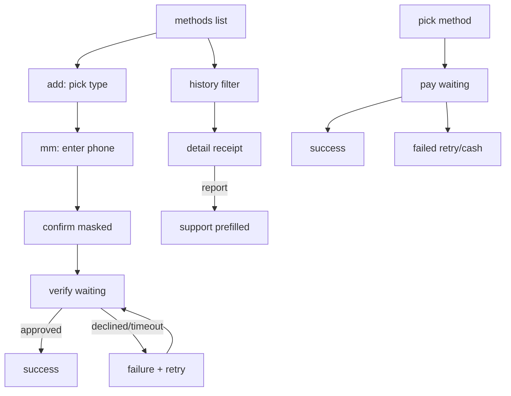
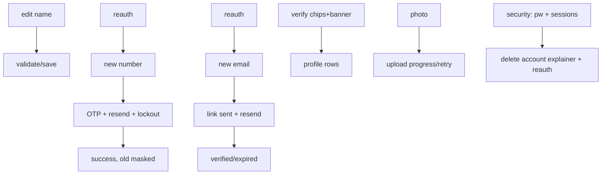
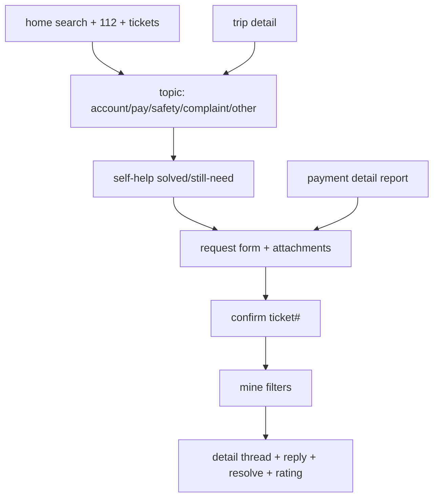

# UI flows — passenger (default)

TARGET: passenger. No SVGs found in workspace (`**/*.svg` empty, no docs/design or assets/design).
Followed existing theme instead: `RidaMintDark #00C875` light + dark `XBg #0A0F14` cards, 12–20dp radius,
Material3, 48dp targets.

## Payment

- Screens/files:
  - `ui/payment/PaymentModels.kt` — providers config `MmProviders.ALL`, `mmReduce`, filters, `PayTripState`.
  - `ui/payment/PaymentFlowScreens.kt` — `PayMethodsFlowScreen`, `AddMethodScreen`, `PayHistoryScreen`, `PayDetailScreen`, `PayTripScreen`.
  - Already existed: `AliveScreens.PaymentMethodsScreen` (overview selector, kept untouched).
- States: content/loading/empty/error, waiting/approved/declined/timed-out/retry/resend countdown, paid/pending/failed/refunded, refresh + load-more.
- Fake: `ui/preview/FakeFlows.FakePayments` (3 methods, 4 records, failure strings).

## Profile editing

- Files: `ui/profile/ProfileEditModels.kt` (`phoneValidateNew`, `phoneSubmitOtp`, `emailValidate`, `passwordStrength`),
  `ui/profile/ProfileFlowScreens.kt` (`EditNameScreen`, `ChangePhoneScreen`, `ChangeEmailScreen`, `ProfileVerifyRows`, `PhotoChangeScreen`, `SecurityScreen`, `DeleteAccountScreen`).
- Already existed: `AliveScreens.PersonalInfoScreen` (simple save, kept).
- Fake: `FakeProfile.sessions()`.

## Support

- Files: `ui/support/SupportModels.kt` (`SupportConfig.REVIEW_HOURS=24`, validators, `ticketChip`),
  `ui/support/SupportFlowScreens.kt` (home, topic, self-help, form, confirm, mine, detail).
- Already existed: `HelpHubScreen`, `HelpCenterScreen`, `HelpArticlesScreen`, `TripHelpScreen`, `SelectRideIssueScreen`, `ContactUsScreen` (kept; new flows reuse/pre-fill them).
- Fake: `FakeSupport.tickets()/thread()`.

## Shared
- `ui/common/TzFormat.kt` (normalize `0712→+255712`, provider map, `TSh 5,000`, masks, OTP, form rules).
- `ui/common/FlowComponents.kt` (`MapPlaceholder`, `StatusChip`, `VerifyChip/Banner`, 48dp buttons/fields).
- `ui/navigation/FlowNavGraphs.kt` — `PaymentFlowNav`, `ProfileFlowNav`, `SupportFlowNav`, `FlowGallery`, `FlowRoutes` typed args.
- Wired in `AppNavGraph` as `pay_flow`, `pay_history`, `profile_flow`, `support_flow`, `flow_gallery` (old routes unchanged).
- Debug: `app/src/debug/.../FlowDebugActivity.kt` + debug manifest; gallery `FlowGallery`.
- Strings: `values/strings.xml` + `values-sw/strings.xml` (short Swahili, whole TZS, +255, Africa/Dar_es_Salaam in fake times).
